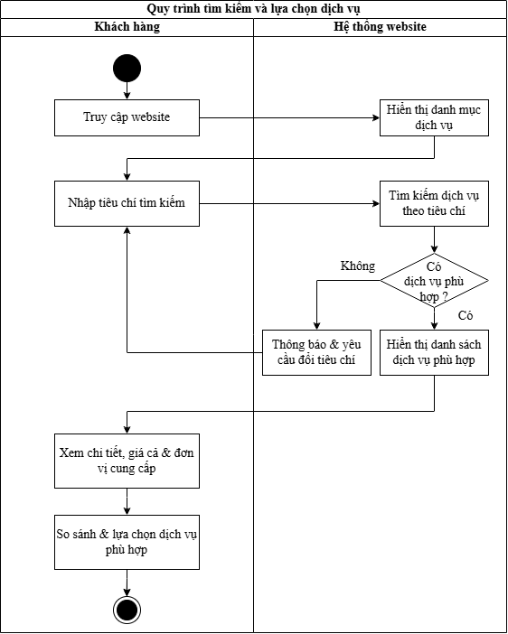
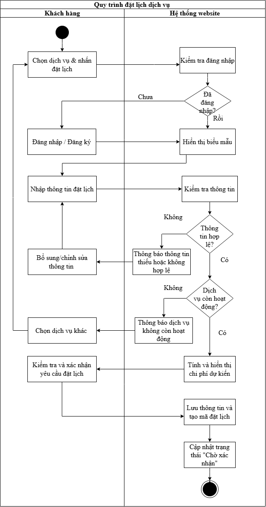
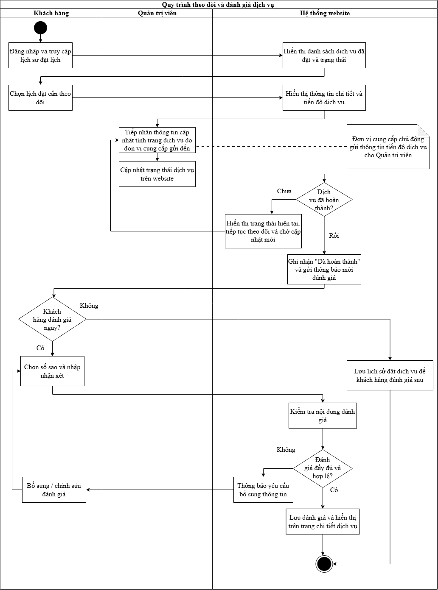

# NHIỆM VỤ 6 – XÁC ĐỊNH QUY TRÌNH NGHIỆP VỤ (3 QUY TRÌNH)

## 1. Quy trình tìm kiếm và lựa chọn dịch vụ

* **Đối tượng tham gia:** Khách hàng, Hệ thống website.
* **Các bước thực hiện:**
  1. Khách hàng truy cập vào website.
  2. Hệ thống hiển thị danh mục các dịch vụ chăm sóc người lớn tuổi.
  3. Khách hàng nhập tiêu chí tìm kiếm gồm loại hình dịch vụ, khu vực và thời gian mong muốn sử dụng.
  4. Hệ thống tìm kiếm và hiển thị danh sách dịch vụ phù hợp.
  5. Khách hàng xem thông tin chi tiết về dịch vụ, giá cả và đơn vị cung cấp.
  6. Khách hàng so sánh và lựa chọn dịch vụ phù hợp với nhu cầu.
  7. Khách hàng chuyển sang quy trình đặt lịch dịch vụ.
* **Trường hợp phát sinh:**
  * Nếu không tìm thấy dịch vụ phù hợp, hệ thống thông báo và đề nghị khách hàng thay đổi tiêu chí tìm kiếm.

### Sơ đồ quy trình tìm kiếm và lựa chọn dịch vụ

---

## 2. Quy trình đặt lịch dịch vụ

* **Đối tượng tham gia:** Khách hàng, Hệ thống website.
* **Các bước thực hiện:**
  1. Khách hàng lựa chọn dịch vụ muốn sử dụng và bắt đầu đặt lịch.
  2. Hệ thống kiểm tra trạng thái đăng nhập của khách hàng.
  3. Nếu khách hàng đã đăng nhập, hệ thống hiển thị biểu mẫu đặt lịch.
  4. Khách hàng nhập thông tin người cần chăm sóc, thông tin liên hệ, địa chỉ, thời gian, thời lượng sử dụng dịch vụ, nhân viên mong muốn (nếu có) và các lưu ý liên quan.
  5. Hệ thống kiểm tra tính hợp lệ của thông tin đặt lịch.
  6. Hệ thống tính toán và hiển thị chi phí dự kiến để khách hàng kiểm tra.
  7. Khách hàng xác nhận gửi yêu cầu đặt lịch.
  8. Hệ thống lưu thông tin, tạo mã đặt lịch và cập nhật trạng thái `"Chờ xác nhận"`.
* **Trường hợp phát sinh:**
  * Nếu khách hàng chưa đăng nhập, hệ thống yêu cầu đăng nhập hoặc đăng ký tài khoản trước khi tiếp tục.
  * Nếu thông tin chưa đầy đủ hoặc không hợp lệ, hệ thống thông báo để khách hàng bổ sung hoặc chỉnh sửa.
  * Nếu dịch vụ không còn hoạt động, hệ thống thông báo để khách hàng lựa chọn dịch vụ khác.

### Sơ đồ quy trình đặt lịch dịch vụ

---

## 3. Quy trình theo dõi và đánh giá dịch vụ

* **Đối tượng tham gia:** Khách hàng, Quản trị viên, Hệ thống website.
* **Các bước thực hiện:**
  1. Khách hàng đăng nhập vào website và truy cập mục lịch sử đặt lịch.
  2. Hệ thống hiển thị danh sách các dịch vụ đã đặt kèm trạng thái hiện tại.
  3. Khách hàng chọn một lịch đặt cụ thể để xem thông tin và tiến độ thực hiện.
  4. Quản trị viên tiếp nhận thông tin về tình trạng thực hiện dịch vụ do đơn vị cung cấp gửi đến, sau đó cập nhật trạng thái tương ứng trên website.
  5. Hệ thống ghi nhận trạng thái `"Đã hoàn thành"` và gửi thông báo mời đánh giá đến khách hàng.
  6. Khách hàng chọn mức độ hài lòng (số sao) và nhập nhận xét về chất lượng dịch vụ.
  7. Hệ thống kiểm tra, lưu thông tin đánh giá và hiển thị trên trang chi tiết dịch vụ.
* **Trường hợp phát sinh:**
  * Nếu dịch vụ chưa hoàn thành, hệ thống chỉ hiển thị thông tin theo dõi và chưa mở chức năng đánh giá.
  * Nếu khách hàng chưa muốn đánh giá ngay, hệ thống vẫn lưu lịch sử để khách hàng có thể đánh giá sau.
  * Nếu nội dung đánh giá thiếu thông tin bắt buộc, hệ thống thông báo để khách hàng bổ sung trước khi gửi.

### Sơ đồ quy trình theo dõi và đánh giá dịch vụ

